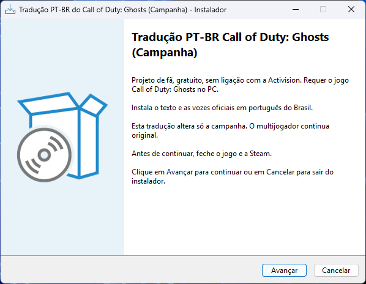

# Call of Duty: Ghosts · Tradução e dublagem PT-BR (Campanha)

Tradução e dublagem em **português do Brasil** da **campanha** do *Call of Duty: Ghosts* para PC, com o **texto e o áudio oficiais em PT-BR**: as mesmas vozes e legendas da versão brasileira oficial do jogo, agora no PC.

> **O site oficial desta tradução é e será apenas este GitHub. Não baixe de outros lugares.**

## Download

**[Baixar a versão 1.0](https://github.com/TiuhKayn/cod-ghosts-ptbr/releases/tag/v1.0)**: o instalador, o `LEIA-ME.txt` e o SHA-256 para conferência.

## Antes de tudo

- **Projeto de fã, gratuito**, sem nenhuma ligação com a Activision ou a Infinity Ward.
- **Precisa do jogo original** *Call of Duty: Ghosts* instalado no PC (versão da **Steam**). Este projeto não traz o jogo.
- **Só a campanha muda.** O **multijogador continua original**: nenhum arquivo do multijogador é trocado.
- Nenhuma voz foi gerada por IA: o áudio é o oficial em português.

## Como instalar

1. Feche o jogo e a Steam.
2. O jogo precisa estar com os arquivos originais. Se você já instalou outra tradução ou outro mod, remova antes.
3. Rode o instalador e clique em **Avançar**.
4. Escolha a pasta do jogo (a pasta onde está o `iw6sp64_ship.exe`). O caminho que aparece é só uma sugestão; use **Procurar...** se o jogo estiver em outro lugar.
5. O instalador confere a pasta antes de mexer em qualquer coisa. Ele explica o motivo e não instala nada se:
   - a pasta for a errada;
   - algum arquivo não for o original;
   - o jogo ou a Steam estiverem abertos;
   - faltar espaço.
6. Clique em **Instalar**. No fim, abra o jogo normalmente: a campanha já estará em português.

Os arquivos originais trocados ficam guardados num backup, em `C:\Program Files (x86)\Ghosts PT-BR Campanha\backup`, e são conferidos pelo SHA-256.

## Como desinstalar

Abra **Configurações > Aplicativos > Aplicativos instalados**, procure **"Tradução PT-BR do Call of Duty: Ghosts (Campanha)"** e clique em **Desinstalar**. No Windows 10 o caminho é **Configurações > Aplicativos > Aplicativos e recursos**.

Os arquivos originais voltam do backup e os arquivos da tradução são apagados.

## Aviso do Windows ("O Windows protegeu o computador")

O instalador **não tem assinatura digital** (o certificado é pago). Por isso o Windows pode mostrar a tela azul **"O Windows protegeu o computador"**. Para continuar:

1. clique em **Mais informações**;
2. clique em **Executar assim mesmo**;
3. o Windows pede permissão de administrador: clique em **Sim**.

Alguns antivírus barram programas sem assinatura, mesmo sem vírus. Antes de liberar, confira se o arquivo é o original: o SHA-256 dele tem de ser igual ao publicado junto do download, na aba Releases. Para ver o SHA, rode no PowerShell `Get-FileHash <arquivo>`. Se não bater, não rode o arquivo.

## Atenção

- Não use **"Verificar integridade dos arquivos"** da Steam com a tradução instalada: isso desfaz parte da tradução. Se acontecer, desinstale e instale de novo.
- Se uma atualização do jogo mudar os arquivos, o instalador recusa, porque a tradução só serve para os arquivos originais desta versão.

## Créditos

Tradução feita por **Kayn** · Instagram [@Kayn_Sla](https://www.instagram.com/kayn_sla/)

*Call of Duty* e *Call of Duty: Ghosts* são marcas da Activision Publishing, Inc. Este é um projeto de fã, sem fins lucrativos.
